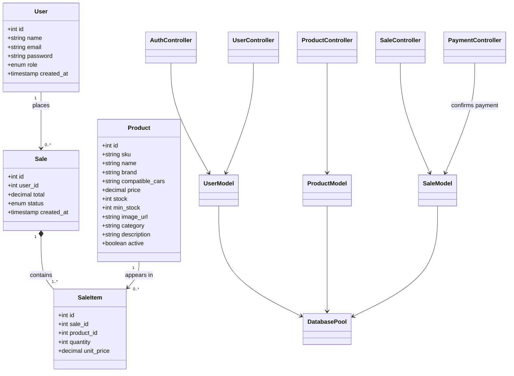

<div align="center">

# AutoPart Pro 🔧

**Sistema web de gestión de inventario y ventas para repuestos automotrices, con módulo de e-commerce integrado.**

[](https://nodejs.org/)
[](https://expressjs.com/)
[](https://www.mysql.com/)
[](https://react.dev/)
[](https://vitejs.dev/)
[](https://tailwindcss.com/)
[](https://jwt.io/)

[English version below ⬇️](#english)

</div>

---

## 📑 Tabla de contenidos

- [Tecnologías](#tecnologías)
- [Funcionalidades](#funcionalidades)
- [Instalación local](#instalación-local)
- [Variables de entorno](#variables-de-entorno)
- [Diccionario de datos](#diccionario-de-datos)
- [Diagrama de clases](#diagrama-de-clases)
- [Manual de despliegue](#manual-de-despliegue)
- [Estructura del proyecto](#estructura-del-proyecto)

---

## Español

### Tecnologías

| Capa | Stack |
|---|---|
| **Backend** | Node.js · Express · MySQL · JWT |
| **Frontend** | React · Vite · Tailwind CSS |
| **Arquitectura** | REST API desacoplada · Patrón MVC · Autenticación por roles |

### Funcionalidades

- 🔐 Autenticación con JWT y roles (`admin`, `employee`, `client`)
- 📦 CRUD completo de productos con alertas de stock mínimo configurable
- 🛒 Carrito de compras y checkout con registro real de ventas
- 📉 Descuento automático de stock al completar una compra
- 📊 Historial de ventas con detalle por producto
- 👥 Gestión de usuarios y roles desde panel de administrador
- ⚡ Notificaciones de stock bajo en tiempo real (`EventEmitter`)
- 🖥️ Panel diferenciado por rol (admin/empleado/cliente)

### Instalación local

**Requisitos:** Node.js 18+, MySQL 8+

```bash
# Clonar el repositorio
git clone https://github.com/JFKoryy/autopart-pro.git
cd autopart-pro

# Backend
cd backend
npm install
# Crear archivo .env con las variables de entorno (ver abajo)
npm run dev

# Frontend (en otra terminal)
cd frontend
npm install
npm run dev
```

### Variables de entorno

**`/backend/.env`**
```env
PORT=5000
DB_HOST=localhost
DB_USER=root
DB_PASSWORD=tu_contraseña
DB_NAME=autopart_pro
JWT_SECRET=tu_clave_secreta
FRONTEND_URL=http://localhost:5173
STORAGE_TYPE=local
```

**`/frontend/.env`**
```env
VITE_API_URL=http://localhost:5000/api
```

En local, el frontend usa la API local y las imágenes se guardan en `backend/uploads/products`.
La configuración de despliegue en AWS (`.github/workflows/deploy.yml`) se conserva y es
independiente de estos archivos `.env`. Para usar S3 en AWS, configura `STORAGE_TYPE=s3`
y las variables de credenciales y bucket en el entorno de despliegue.

### Diccionario de datos

La fuente del esquema es [`backend/database.sql`](./backend/database.sql). La base de datos se llama `autopart_pro`. Los tipos y valores predeterminados siguientes corresponden al esquema después de ejecutar el script completo en una base de datos nueva.

#### `users` — cuentas y roles

| Campo | Tipo | Nulo | Clave / predeterminado | Descripción |
|---|---|---:|---|---|
| `id` | `INT` | No | PK, autoincremental | Identificador del usuario. |
| `name` | `VARCHAR(100)` | No | — | Nombre visible. |
| `email` | `VARCHAR(100)` | No | UNIQUE | Correo de inicio de sesión. |
| `password` | `VARCHAR(255)` | No | — | Hash de contraseña; no almacenar texto plano. |
| `role` | `ENUM('admin','employee','client')` | No | `client` | Rol de autorización. |
| `created_at` | `TIMESTAMP` | No | `CURRENT_TIMESTAMP` | Fecha de creación. |

#### `products` — catálogo e inventario

| Campo | Tipo | Nulo | Clave / predeterminado | Descripción |
|---|---|---:|---|---|
| `id` | `INT` | No | PK, autoincremental | Identificador del producto. |
| `sku` | `VARCHAR(50)` | No | UNIQUE | Código único de inventario. |
| `name` | `VARCHAR(255)` | No | — | Nombre del repuesto. |
| `brand` | `VARCHAR(100)` | No | — | Marca del repuesto. |
| `compatible_cars` | `TEXT` | Sí | `NULL` | Vehículos compatibles en texto libre. |
| `price` | `DECIMAL(10,2)` | No | `0.00` | Precio en moneda local (COP en el checkout actual). |
| `stock` | `INT` | No | `0` | Unidades disponibles. |
| `created_at` | `TIMESTAMP` | No | `CURRENT_TIMESTAMP` | Fecha de creación. |
| `updated_at` | `TIMESTAMP` | No | `CURRENT_TIMESTAMP`, actualización automática | Última modificación. |
| `min_stock` | `INT` | No | `5` | Umbral usado para alertas de stock bajo. |
| `image_url` | `VARCHAR(255)` | Sí | `NULL` | URL de imagen local o de almacenamiento remoto. |
| `category` | `VARCHAR(100)` | Sí | `NULL` | Categoría para el catálogo. |
| `description` | `TEXT` | Sí | `NULL` | Descripción del producto. |
| `active` | `BOOLEAN` | Sí | `TRUE` | Visibilidad lógica. El catálogo público consulta solo productos activos. |

#### `sales` — cabecera de venta

| Campo | Tipo | Nulo | Clave / predeterminado | Descripción |
|---|---|---:|---|---|
| `id` | `INT` | No | PK, autoincremental | Identificador de la venta. |
| `user_id` | `INT` | No | FK → `users.id` | Usuario que realizó la compra. |
| `total` | `DECIMAL(10,2)` | No | — | Importe total registrado. |
| `status` | `ENUM('pending','completed','cancelled')` | Sí | `completed` | Estado de la venta. |
| `created_at` | `TIMESTAMP` | No | `CURRENT_TIMESTAMP` | Fecha de creación. |

#### `sale_items` — productos de cada venta

| Campo | Tipo | Nulo | Clave / predeterminado | Descripción |
|---|---|---:|---|---|
| `id` | `INT` | No | PK, autoincremental | Identificador del renglón. |
| `sale_id` | `INT` | No | FK → `sales.id`, borrado en cascada | Venta a la que pertenece. |
| `product_id` | `INT` | No | FK → `products.id` | Producto vendido. |
| `quantity` | `INT` | No | — | Unidades del producto. |
| `unit_price` | `DECIMAL(10,2)` | No | — | Precio unitario registrado en la venta. |

#### `test_connection` — tabla auxiliar de comprobación

| Campo | Tipo | Nulo | Clave / predeterminado | Descripción |
|---|---|---:|---|---|
| `id` | `INT` | No | PK, autoincremental | Identificador de la prueba. |
| `status_message` | `VARCHAR(255)` | No | — | Mensaje insertado al crear el esquema. |
| `created_at` | `TIMESTAMP` | No | `CURRENT_TIMESTAMP` | Fecha de inserción. |

#### Relaciones y reglas de datos

- Un usuario puede tener muchas ventas; cada venta pertenece a un usuario.
- Una venta contiene uno o más renglones; cada renglón apunta a un producto.
- Al borrar una venta, sus renglones se borran en cascada. El esquema no define borrado en cascada para usuarios ni productos.
- `users.email` y `products.sku` son únicos.
- El borrado de productos desde la aplicación es lógico: establece `active = FALSE`, no elimina el registro.
- La creación de ventas registra cabecera y renglones en una transacción y descuenta existencias.
- `compatible_cars` es texto libre, no una relación a una tabla de vehículos.

### Diagrama de clases

El diagrama representa las entidades persistidas y las clases principales del backend. Los modelos ejecutan consultas mediante el pool MySQL; los controladores coordinan las solicitudes de Express.

```mermaid
classDiagram
    class User {
        +int id
        +string name
        +string email
        +string password
        +enum role
        +timestamp created_at
    }
    class Product {
        +int id
        +string sku
        +string name
        +string brand
        +string compatible_cars
        +decimal price
        +int stock
        +int min_stock
        +string image_url
        +string category
        +string description
        +boolean active
    }
    class Sale {
        +int id
        +int user_id
        +decimal total
        +enum status
        +timestamp created_at
    }
    class SaleItem {
        +int id
        +int sale_id
        +int product_id
        +int quantity
        +decimal unit_price
    }
    class AuthController
    class ProductController
    class SaleController
    class PaymentController
    class UserController
    class UserModel
    class ProductModel
    class SaleModel
    class DatabasePool

    User "1" --> "0..*" Sale : realiza
    Sale "1" *-- "1..*" SaleItem : contiene
    Product "1" --> "0..*" SaleItem : aparece en

    AuthController --> UserModel
    UserController --> UserModel
    ProductController --> ProductModel
    SaleController --> SaleModel
    PaymentController --> SaleModel : confirma pago
    UserModel --> DatabasePool
    ProductModel --> DatabasePool
    SaleModel --> DatabasePool
```



### Manual de despliegue

#### A. Ejecución local

1. Instala Node.js 18 o superior y MySQL 8. Inicia el servicio MySQL.
2. Crea una base de datos local con el esquema del proyecto. Para una base nueva, desde la raíz del repositorio:

   ```bash
   mysql -h localhost -P 3306 -u root -p < backend/database.sql
   ```

   También se puede abrir y ejecutar `backend/database.sql` en MySQL Workbench. El script incluye `ALTER TABLE` sin comprobación de existencia: úsalo como inicialización de una base nueva, no lo vuelvas a ejecutar sobre un esquema ya inicializado.
3. Crea `backend/.env` con los datos de conexión, un `JWT_SECRET` aleatorio y `FRONTEND_URL=http://localhost:5173`. Para guardar imágenes localmente, configura `STORAGE_TYPE=local`. No subas `.env` al repositorio.
4. En una terminal:

   ```bash
   cd backend
   npm install
   npm run dev
   ```

5. Crea `frontend/.env` con `VITE_API_URL=http://localhost:5000/api`. En otra terminal:

   ```bash
   cd frontend
   npm install
   npm run dev
   ```

6. Abre `http://localhost:5173/catalogo`. Verifica `http://localhost:5000/api/health` y `http://localhost:5000/api/products`. Si accedes al frontend desde otro dispositivo, usa la IP del equipo que ejecuta Vite como `FRONTEND_URL`, agrega esa misma URL a CORS y configura `VITE_API_URL` con una dirección del backend accesible desde ese dispositivo; reinicia ambos servidores después de cambiar variables.

#### B. AWS (Elastic Beanstalk, RDS, S3 y CloudFront)

La automatización está en [`.github/workflows/deploy.yml`](./.github/workflows/deploy.yml): se ejecuta al hacer `push` a `main`, despliega el backend a Elastic Beanstalk y sincroniza `frontend/dist` a un bucket S3. Los recursos de AWS deben existir antes de ejecutar el workflow.

1. **Prepara AWS y la región.** El workflow usa `us-east-2`, la aplicación Elastic Beanstalk `autopart-pro`, el entorno `autopart-pro-env` y el bucket del frontend `autopart-pro-frontend`. Crea esos recursos con nombres/región compatibles o actualiza el workflow para que coincida con tus recursos. Configura presupuesto y alertas de costos.
2. **Crea RDS MySQL 8.** Crea una instancia y una base `autopart_pro`. Configura red y grupos de seguridad para permitir TCP `3306` desde el grupo de seguridad de Elastic Beanstalk; evita exponer RDS públicamente. Ejecuta `backend/database.sql` una sola vez en la instancia nueva. Mantén copias de seguridad y aplica cambios posteriores de esquema mediante migraciones controladas.
3. **Crea el entorno backend.** Usa una plataforma Node.js compatible con Node 22. Configura en Elastic Beanstalk las variables descritas abajo. El endpoint de RDS será `DB_HOST`; confirma que el backend pueda resolverlo y conectarse. Para imágenes, crea el bucket S3 y permite que la identidad/rol del backend cargue, lea y elimine objetos. El navegador carga las imágenes con una petición `PUT` directa a S3 usando una URL prefirmada: configura CORS en el bucket para el origen HTTPS exacto de CloudFront, el método `PUT` y el encabezado `Content-Type`. Si las imágenes no deben ser públicas, entrégalas mediante CloudFront o URLs firmadas de lectura; el backend actualmente guarda una URL S3 directa.
4. **Publica el frontend.** Configura el bucket `autopart-pro-frontend` como destino de los archivos estáticos y crea/distribuye CloudFront delante de él. Configura la distribución para servir `index.html` en las rutas de la SPA (por ejemplo, `/catalogo`). `VITE_API_URL` debe ser la URL HTTPS pública de la API de Elastic Beanstalk. La URL pública del frontend debe estar permitida por CORS y establecerse como `FRONTEND_URL`.
5. **Configura GitHub Actions.** En los secretos del repositorio define:

   | Secreto | Uso |
   |---|---|
   | `AWS_ACCESS_KEY_ID` | Credencial usada por el workflow para publicar backend y frontend. |
   | `AWS_SECRET_ACCESS_KEY` | Secreto asociado a la credencial AWS anterior. |
   | `VITE_API_URL` | URL HTTPS de la API, incorporada durante la compilación del frontend. |

   Otorga a esa identidad únicamente los permisos requeridos para desplegar en Elastic Beanstalk y sincronizar el bucket frontend en la región configurada. El paso de sincronización usa `--delete`: el bucket frontend debe estar dedicado a los archivos generados, ya que los objetos que no existan en `frontend/dist` se eliminan.
6. **Despliega y valida.** Publica los cambios en `main` y revisa ambos jobs en la pestaña **Actions**. Comprueba `/api/health`, `/api/products`, el catálogo servido por CloudFront, el acceso a imágenes y las operaciones de autenticación. Revisa los logs de Elastic Beanstalk si falla el backend. Si el navegador reporta CORS, permite el origen exacto del frontend (protocolo, dominio y puerto) en la configuración del backend y vuelve a desplegar.

Variables del entorno de Elastic Beanstalk:

| Variable | Requerida | Valor / uso |
|---|---:|---|
| `PORT` | No | Elastic Beanstalk asigna el puerto; localmente se usa `5000` por defecto. |
| `DB_HOST` | Sí | Endpoint DNS de RDS, sin protocolo ni puerto. |
| `DB_PORT` | No | Puerto MySQL; por defecto `3306`. |
| `DB_USER` | Sí | Usuario MySQL de la aplicación. |
| `DB_PASSWORD` | Sí | Contraseña MySQL, guardada como configuración segura del entorno. |
| `DB_NAME` | Sí | `autopart_pro`. |
| `JWT_SECRET` | Sí | Secreto aleatorio y privado para firmar tokens. |
| `FRONTEND_URL` | Sí | URL HTTPS pública de la web; se usa para CORS y retornos de Stripe. |
| `STORAGE_TYPE` | Sí | `s3` en AWS; `local` en desarrollo. |
| `AWS_REGION` | Para S3 | Región del bucket de imágenes, por ejemplo `us-east-2`. |
| `S3_BUCKET_IMAGES` | Para S3 | Nombre del bucket que contiene las imágenes de productos. |
| `AWS_ACCESS_KEY_ID` / `AWS_SECRET_ACCESS_KEY` | Para S3 según la configuración actual | Credenciales con permisos limitados sobre el bucket de imágenes. Nunca las guardes en el repositorio. |
| `STRIPE_SECRET_KEY` | Para pagos | Clave privada de Stripe correspondiente al entorno de pago. |
| `STRIPE_WEBHOOK_SECRET` | Para pagos | Secreto del webhook configurado en Stripe para `/api/payments/webhook`. |

El workflow no crea la instancia RDS, el bucket de imágenes ni la distribución CloudFront y tampoco configura las variables del entorno Elastic Beanstalk: son pasos manuales de aprovisionamiento. La configuración AWS se mantiene separada de los `.env` locales.

### Estructura del proyecto

```text
backend/src/
  config/        → conexión a MySQL
  models/        → queries SQL
  controllers/   → lógica de negocio
  middleware/    → auth, roles, validación
  routes/        → endpoints de la API
  events/        → EventEmitter para stock bajo

frontend/src/
  components/    → componentes reutilizables
  pages/         → vistas por módulo
  services/      → llamadas a la API
  context/       → AuthContext, CartContext
```

---

## English

### Tech Stack

| Layer | Stack |
|---|---|
| **Backend** | Node.js · Express · MySQL · JWT |
| **Frontend** | React · Vite · Tailwind CSS |
| **Architecture** | Decoupled REST API · MVC pattern · Role-based authentication |

### Features

- 🔐 JWT authentication with roles (`admin`, `employee`, `client`)
- 📦 Full product CRUD with configurable minimum stock alerts
- 🛒 Shopping cart and checkout with real sales recording
- 📉 Automatic stock deduction on purchase completion
- 📊 Sales history with product-level detail
- 👥 User and role management from admin panel
- ⚡ Real-time low stock notifications (`EventEmitter`)
- 🖥️ Role-based dashboard (admin/employee/client)

### Local Setup

**Requirements:** Node.js 18+, MySQL 8+

```bash
# Clone the repository
git clone https://github.com/JFKoryy/autopart-pro.git
cd autopart-pro

# Backend (first terminal)
cd backend
npm install
# Create .env using the settings below
npm run dev

# Frontend (second terminal)
cd frontend
npm install
npm run dev
```

### Environment Variables

**`/backend/.env`**
```env
PORT=5000
DB_HOST=localhost
DB_PORT=3306
DB_USER=root
DB_PASSWORD=your_password
DB_NAME=autopart_pro
JWT_SECRET=your_random_secret
FRONTEND_URL=http://localhost:5173
STORAGE_TYPE=local
```

**`/frontend/.env`**
```env
VITE_API_URL=http://localhost:5000/api
```

For local development, the frontend uses the local API and images are stored in `backend/uploads/products`.
The AWS deployment workflow (`.github/workflows/deploy.yml`) is separate from local `.env` files.
For AWS image storage, set `STORAGE_TYPE=s3` and configure the required AWS variables in the deployment environment.

### Data Dictionary

The schema source is [`backend/database.sql`](./backend/database.sql). The database is named `autopart_pro`.
The types and defaults below describe the schema after the complete script has been run on a new database.

#### `users` — accounts and roles

| Field | Type | Nullable | Key / default | Description |
|---|---|---:|---|---|
| `id` | `INT` | No | PK, auto-increment | User identifier. |
| `name` | `VARCHAR(100)` | No | — | Display name. |
| `email` | `VARCHAR(100)` | No | UNIQUE | Login email address. |
| `password` | `VARCHAR(255)` | No | — | Password hash; never store plain-text passwords. |
| `role` | `ENUM('admin','employee','client')` | No | `client` | Authorization role. |
| `created_at` | `TIMESTAMP` | No | `CURRENT_TIMESTAMP` | Account creation time. |

#### `products` — catalog and inventory

| Field | Type | Nullable | Key / default | Description |
|---|---|---:|---|---|
| `id` | `INT` | No | PK, auto-increment | Product identifier. |
| `sku` | `VARCHAR(50)` | No | UNIQUE | Unique inventory code. |
| `name` | `VARCHAR(255)` | No | — | Part name. |
| `brand` | `VARCHAR(100)` | No | — | Part brand. |
| `compatible_cars` | `TEXT` | Yes | `NULL` | Compatible vehicles stored as free text. |
| `price` | `DECIMAL(10,2)` | No | `0.00` | Price in local currency (currently COP at checkout). |
| `stock` | `INT` | No | `0` | Available units. |
| `created_at` | `TIMESTAMP` | No | `CURRENT_TIMESTAMP` | Creation time. |
| `updated_at` | `TIMESTAMP` | No | `CURRENT_TIMESTAMP`, auto-updated | Last modification time. |
| `min_stock` | `INT` | No | `5` | Threshold used for low-stock alerts. |
| `image_url` | `VARCHAR(255)` | Yes | `NULL` | Local or remote image URL. |
| `category` | `VARCHAR(100)` | Yes | `NULL` | Catalog category. |
| `description` | `TEXT` | Yes | `NULL` | Product description. |
| `active` | `BOOLEAN` | Yes | `TRUE` | Logical visibility. The public catalog only queries active products. |

#### `sales` — sale header

| Field | Type | Nullable | Key / default | Description |
|---|---|---:|---|---|
| `id` | `INT` | No | PK, auto-increment | Sale identifier. |
| `user_id` | `INT` | No | FK → `users.id` | User who placed the order. |
| `total` | `DECIMAL(10,2)` | No | — | Recorded sale total. |
| `status` | `ENUM('pending','completed','cancelled')` | Yes | `completed` | Sale status. |
| `created_at` | `TIMESTAMP` | No | `CURRENT_TIMESTAMP` | Creation time. |

#### `sale_items` — products in a sale

| Field | Type | Nullable | Key / default | Description |
|---|---|---:|---|---|
| `id` | `INT` | No | PK, auto-increment | Sale line identifier. |
| `sale_id` | `INT` | No | FK → `sales.id`, cascading delete | Parent sale. |
| `product_id` | `INT` | No | FK → `products.id` | Sold product. |
| `quantity` | `INT` | No | — | Number of units. |
| `unit_price` | `DECIMAL(10,2)` | No | — | Unit price recorded for the sale. |

#### `test_connection` — connection check table

| Field | Type | Nullable | Key / default | Description |
|---|---|---:|---|---|
| `id` | `INT` | No | PK, auto-increment | Test row identifier. |
| `status_message` | `VARCHAR(255)` | No | — | Message inserted when initializing the schema. |
| `created_at` | `TIMESTAMP` | No | `CURRENT_TIMESTAMP` | Insertion time. |

#### Relationships and data rules

- A user can have many sales; each sale belongs to one user.
- A sale contains one or more line items; each line item references one product.
- Deleting a sale cascades to its line items. The schema does not define cascading deletes for users or products.
- `users.email` and `products.sku` are unique.
- Product deletion in the application is logical: it sets `active = FALSE` instead of removing the row.
- Sale creation writes the sale header and items in a transaction and decrements product stock.
- `compatible_cars` is free text, not a relationship to a vehicle table.

### Class Diagram

The diagram shows the persisted entities and the backend's main classes. Models run queries through the MySQL pool; controllers coordinate Express requests.



### Deployment Guide

#### A. Local deployment

1. Install Node.js 18 or later and MySQL 8. Start the MySQL service.
2. Initialize a local database with the project schema. For a new database, run this from the repository root:

   ```bash
   mysql -h localhost -P 3306 -u root -p < backend/database.sql
   ```

   You can also open and run `backend/database.sql` in MySQL Workbench. The script contains `ALTER TABLE` statements without existence checks: use it to initialize a new database, not to reinitialize an existing schema.
3. Create `backend/.env` with the database connection details, a random `JWT_SECRET`, and `FRONTEND_URL=http://localhost:5173`. Set `STORAGE_TYPE=local` to store images locally. Do not commit `.env`.
4. In a terminal, start the backend:

   ```bash
   cd backend
   npm install
   npm run dev
   ```

5. Create `frontend/.env` with `VITE_API_URL=http://localhost:5000/api`. In a second terminal, start the frontend:

   ```bash
   cd frontend
   npm install
   npm run dev
   ```

6. Open `http://localhost:5173/catalogo`. Verify `http://localhost:5000/api/health` and `http://localhost:5000/api/products`. To access the frontend from another device, use the host machine's IP in `FRONTEND_URL`, allow that exact URL in backend CORS, and set `VITE_API_URL` to a backend address reachable from the device. Restart both servers after changing environment variables.

#### B. AWS (Elastic Beanstalk, RDS, S3, and CloudFront)

The automation is defined in [`.github/workflows/deploy.yml`](./.github/workflows/deploy.yml). It runs on pushes to `main`, deploys the backend to Elastic Beanstalk, and syncs `frontend/dist` to an S3 bucket. AWS resources must exist before running the workflow.

1. **Prepare AWS and the region.** The workflow uses `us-east-2`, Elastic Beanstalk application `autopart-pro`, environment `autopart-pro-env`, and frontend bucket `autopart-pro-frontend`. Create compatible resources or update the workflow to match your resource names and region. Configure budgets and cost alerts.
2. **Create RDS MySQL 8.** Create an instance and an `autopart_pro` database. Configure networking and security groups to allow TCP `3306` from the Elastic Beanstalk security group; avoid exposing RDS publicly. Run `backend/database.sql` once on the new database. Keep backups and use controlled migrations for future schema changes.
3. **Create the backend environment.** Use a Node.js platform compatible with Node 22. Configure the environment variables listed below in Elastic Beanstalk. Set `DB_HOST` to the RDS endpoint and confirm the backend can resolve and connect to it. For images, create an S3 bucket and grant the backend identity/role permission to upload, read, and delete objects. The browser uploads images directly to S3 using a presigned `PUT` URL: configure bucket CORS for the exact CloudFront HTTPS origin, the `PUT` method, and the `Content-Type` header. If images should not be public, serve them through CloudFront or signed read URLs; the current backend stores a direct S3 URL.
4. **Publish the frontend.** Configure `autopart-pro-frontend` as the static site bucket and put a CloudFront distribution in front of it. Configure the distribution to serve `index.html` for SPA routes such as `/catalogo`. Set `VITE_API_URL` to the public HTTPS Elastic Beanstalk API URL. Allow the public frontend URL in backend CORS and set it as `FRONTEND_URL`.
5. **Configure GitHub Actions.** Add these repository secrets:

   | Secret | Purpose |
   |---|---|
   | `AWS_ACCESS_KEY_ID` | Credential used by the workflow to publish the backend and frontend. |
   | `AWS_SECRET_ACCESS_KEY` | Secret associated with the AWS credential. |
   | `VITE_API_URL` | HTTPS API URL embedded in the frontend build. |

   Grant this identity only the permissions required to deploy to Elastic Beanstalk and sync the frontend bucket in the configured region. The sync step uses `--delete`: dedicate the frontend bucket to generated site files because objects missing from `frontend/dist` will be deleted.
6. **Deploy and verify.** Push changes to `main` and monitor both jobs in the **Actions** tab. Verify `/api/health`, `/api/products`, the CloudFront-hosted catalog, image access, and authentication. Check Elastic Beanstalk logs if the backend fails. If the browser reports a CORS error, allow the exact frontend origin (scheme, hostname, and port) in the backend and redeploy.

Elastic Beanstalk environment variables:

| Variable | Required | Value / purpose |
|---|---:|---|
| `PORT` | No | Assigned by Elastic Beanstalk; defaults to `5000` locally. |
| `DB_HOST` | Yes | RDS DNS endpoint, without scheme or port. |
| `DB_PORT` | No | MySQL port; defaults to `3306`. |
| `DB_USER` | Yes | Application's MySQL user. |
| `DB_PASSWORD` | Yes | MySQL password, stored as secure environment configuration. |
| `DB_NAME` | Yes | `autopart_pro`. |
| `JWT_SECRET` | Yes | Private random secret used to sign tokens. |
| `FRONTEND_URL` | Yes | Public HTTPS web URL; used for CORS and Stripe return URLs. |
| `STORAGE_TYPE` | Yes | `s3` on AWS; `local` for development. |
| `AWS_REGION` | For S3 | Image bucket region, for example `us-east-2`. |
| `S3_BUCKET_IMAGES` | For S3 | Name of the bucket containing product images. |
| `AWS_ACCESS_KEY_ID` / `AWS_SECRET_ACCESS_KEY` | Required for S3 with the current configuration | Credentials limited to the image bucket. Never commit them. |
| `STRIPE_SECRET_KEY` | For payments | Private Stripe key for the payment environment. |
| `STRIPE_WEBHOOK_SECRET` | For payments | Secret for the Stripe webhook configured at `/api/payments/webhook`. |

The workflow does not create the RDS instance, image bucket, or CloudFront distribution, nor does it configure Elastic Beanstalk environment variables; these are manual provisioning steps. AWS deployment settings remain separate from local `.env` files.

### Project Structure

```text
backend/src/
  config/        → MySQL connection
  models/        → SQL queries
  controllers/   → business logic
  middleware/    → auth, roles, validation
  routes/        → API endpoints
  events/        → EventEmitter for low stock

frontend/src/
  components/    → reusable components
  pages/         → module views
  services/      → API calls
  context/       → AuthContext, CartContext
```
